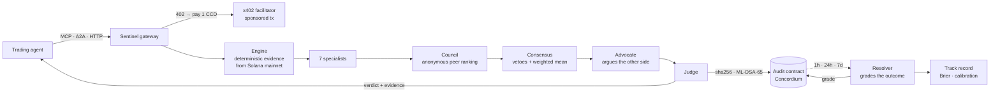
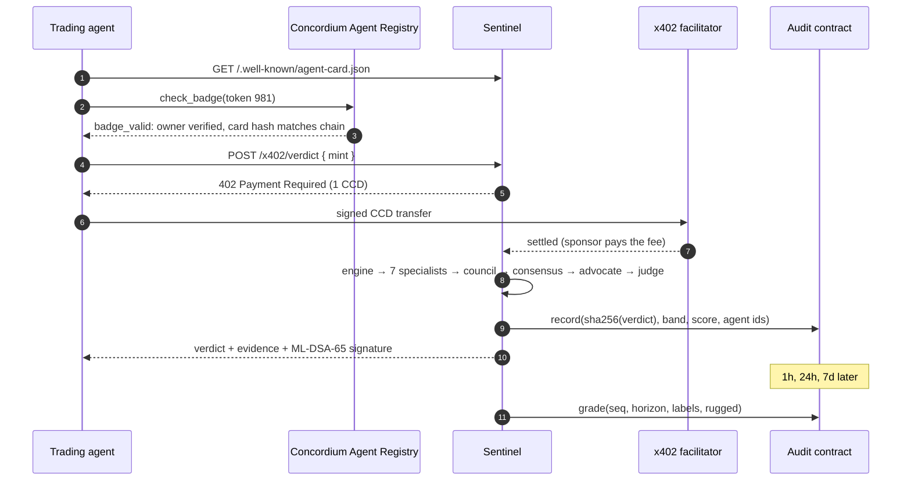
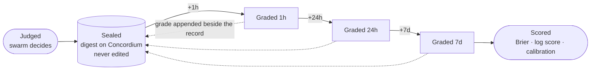
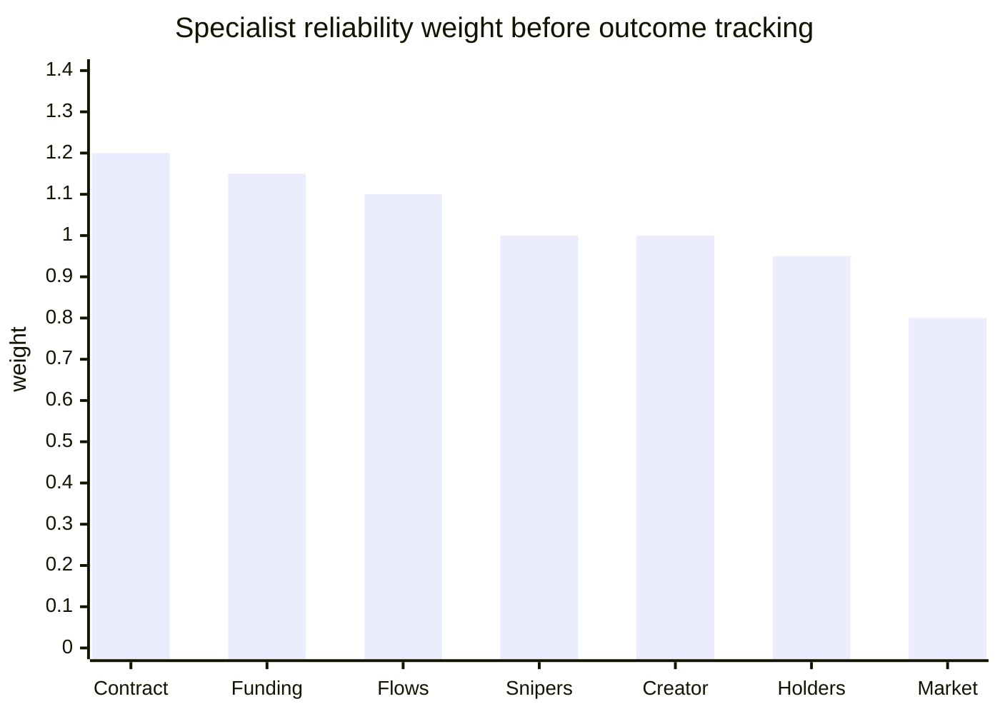
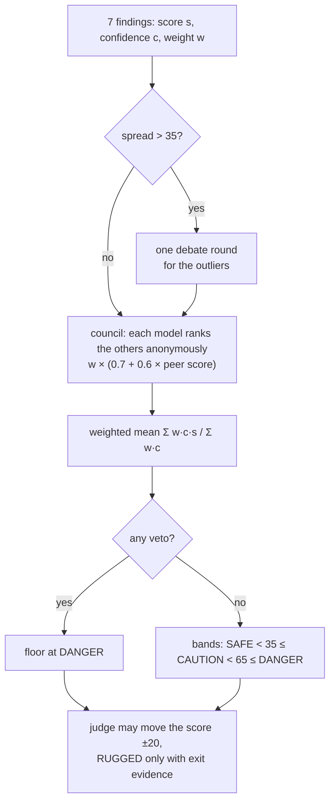
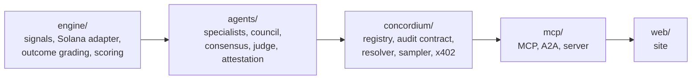

<div align="center">

# SENTINEL

**The rug-check oracle for AI agents that keeps score on itself.**

Every verdict is sealed on Concordium before the outcome and graded after it.

[](https://sentinelagent.pro)
[](https://api.sentinelagent.pro/healthz)
[](https://testnet.ccdscan.io/contracts/13039/0)
[](concordium/cards/registry.json)
[](mcp/README.md)
[](https://api.sentinelagent.pro/a2a)
[](concordium/src/x402.ts)
[](https://api.sentinelagent.pro/.well-known/sentinel-keys.json)
[](#tests)
[](tsconfig.base.json)
[](concordium/audit-contract/src/lib.rs)
[](LICENSE)

[Site](https://sentinelagent.pro) · [Track record](https://sentinelagent.pro/track) · [Audit trail](https://sentinelagent.pro/audit) · [Agents](https://sentinelagent.pro/agents) · [Docs](https://sentinelagent.pro/docs)

</div>

---

## Why

AI agents already trade memecoins on Solana, and most of those coins are built to rug. Between 74 % and 84 % of pump.fun launches collapse soon after launch ([MemeTrans, arXiv:2602.13480](https://arxiv.org/abs/2602.13480)). Agents can buy a rug check for a fraction of a cent today. What they cannot buy is a check that **answers for itself**. Every incumbent returns a score and walks away. None of them publishes how its past calls turned out.

Sentinel publishes how its past calls turned out.

| | Typical rug checker | Sentinel |
|---|---|---|
| Output | a score | a verdict, the evidence behind it, and the dissent |
| Who answers for it | nobody | nine agents in the Concordium Agent Registry, owned by one verified human |
| Record of the call | none | `sha256(verdict)` appended to a contract on Concordium **before** the outcome |
| Was it right? | unknown | graded on chain at 1 h, 24 h and 7 d; Brier score and calibration published |
| Paid by | API key, subscription | the calling agent, per verdict, over x402 (no gas: sponsored transaction) |
| Signed | no | ML-DSA-65 (post-quantum) by the judge key |

## How it works



### One paid verdict, end to end



### The life of a verdict



## The swarm

Facts are code, judgement is the model. The engine computes every number from Solana mainnet with deterministic, tested code. Each specialist sees one evidence domain and returns a typed finding with a risk score, a confidence and the evidence it used.

| Agent | Reads | Weight | Can veto | Token |
|---|---|---:|---|---:|
| Contract & Liquidity | mint and freeze authority, Token-2022 extensions, LP lock | 1.20 | mint or freeze authority live, permanent delegate, pullable LP | 987 |
| Funding Graph | who funded the top wallets, shared funders, exchange hot wallets | 1.15 | | 985 |
| Money Flow | where the SOL went after the sell, up to three hops | 1.10 | creator cashed out to an exchange | 989 |
| Snipers & Bundles | first-slot buyers, same-slot bundles, what they still hold | 1.00 | | 984 |
| Creator | sold, locked or holding; launch history | 1.00 | | 986 |
| Holders | concentration, lockers, burned supply | 0.95 | | 983 |
| Market | liquidity, volume, price shape across every pool | 0.80 | liquidity drained | 988 |
| Judge | the findings, the council ranking, the advocate | | | 982 |
| Gateway | MCP, A2A, x402 entry point | | | 981 |



### Consensus rule

The rule is code, and it can overrule the judge.



The design follows what the literature says about multi-agent judgement. Debate is capped at one round with a central judge, because sycophantic debates fall below a single agent ([arXiv:2509.23055](https://arxiv.org/abs/2509.23055)). The council is anonymous, because anonymity removes identity-driven conformity ([arXiv:2510.07517](https://arxiv.org/abs/2510.07517)). The advocate's rebuttal is kept as a separate record and never folded into the score.

## The track record

A verdict's `riskScore / 100` is its forecast that the token rugs. The resolver grades every sealed verdict with the labels from [Catching the Rug (arXiv:2608.20271)](https://arxiv.org/abs/2608.20271):

| Label | Meaning |
|---|---|
| `tvl_rug` | liquidity fell more than 99 % since the verdict |
| `idle` | no trades in the last 24 h (from the 24 h horizon on) |
| `drained` | a pool under 1 % of the market cap |
| `price_collapse` + `creator_exit` | the creator left and the price went with them |

Scores are strictly proper: Brier and log score reward honest probabilities, not confident ones. Skill is measured against the base rate, because a flat "90 % rug" guess already scores well on launchpad tokens. A **launch sampler** judges random live pump.fun launches on a fixed clock, so the track is not built only from tokens people chose to ask about.

Live: [sentinelagent.pro/track](https://sentinelagent.pro/track) · `GET https://api.sentinelagent.pro/track` · MCP tool `sentinel_track`.

## Concordium integration

| Component | How Sentinel uses it | Where |
|---|---|---|
| **Agent Registry (CIS-8004)** | nine agents, tokens 981–989, cards served byte-exact and hash-pinned | [`registry.ts`](concordium/src/registry.ts), [`cards/`](concordium/cards) |
| **Verified by Concordium badge** | all nine valid; owner account backed by Concordium ID | [check it](https://agent-registry-mcp.concordium.com/v1/check-badge/JyP9XuYWbM5LAuY1BXBRN?network=testnet) |
| **Agent Registry MCP** | the demo trader agent checks Sentinel's badge before paying | [`trader-agent.ts`](concordium/src/scripts/trader-agent.ts) |
| **x402** | 1 CCD per verdict over HTTP and MCP, in-process facilitator | [`x402.ts`](concordium/src/x402.ts) |
| **Sponsored transactions** | the facilitator pays the fee, the calling agent holds no gas | [`x402.ts`](concordium/src/x402.ts) |
| **Smart contract** | `sentinel_audit`: append-only verdict records and outcome grades | [`lib.rs`](concordium/audit-contract/src/lib.rs) |

### Live on testnet

| | |
|---|---|
| Audit contract | [`<13039,0>`](https://testnet.ccdscan.io/contracts/13039/0) |
| Agent Registry | CIS-8004 `<12802,0>`, CIS-8 `<12801,0>` |
| Verdict signing key | [`/.well-known/sentinel-keys.json`](https://api.sentinelagent.pro/.well-known/sentinel-keys.json) |

| Agent | Token | Badge token address |
|---|---:|---|
| Sentinel (gateway) | 981 | `JyP9XuYWbM5LAuY1BXBRN` |
| Judge | 982 | `JyP9XvdzXNaG12mhEPWxc` |
| Holders | 983 | `JyP9XwjUTQ5BqA1U88GxH` |
| Snipers & Bundles | 984 | `JyP9XxpxPRa7fHFHdSi8f` |
| Funding Graph | 985 | `JyP9XyvSKT53VQV4eCrRY` |
| Creator | 986 | `JyP9Y11vFUZyKXirwTVGZ` |
| Contract & Liquidity | 987 | `JyP9Y27QBW4u9exdA4hkR` |
| Market | 988 | `JyP9Y3Ct7XZpynCTKGUka` |
| Money Flow | 989 | `JyP9Y4JN3Z4kouSAhLdSi` |

### Contract interface

```
record        RecordParam { digest, chain, subject, verdict, risk_score, agent_ids, observed_at } → seq
grade         GradeParam  { seq, horizon, labels, rugged, liquidity_bps, price_bps, observed_at }
view(seq)     → Record          grades(seq) → [Grade]          count() · info()
setSubmitter  admin only
events        Verdict · Graded · SubmitterChanged
```

Only authorised submitters can write. Nothing can be updated or deleted. Each horizon can be graded once.

## Use it from an agent

**MCP** (Streamable HTTP): `https://api.sentinelagent.pro/mcp`

| Tool | Price | Returns |
|---|---|---|
| `sentinel_verdict { mint }` | 1 CCD over x402 | verdict, evidence, dissent, attestation; progress as notifications |
| `sentinel_track { limit? }` | free | Brier, skill, reliability, per-specialist scores, graded verdicts |
| `sentinel_audit { digest? \| mint? }` | free | past verdicts with their Concordium records |
| `sentinel_agents` | free | the nine agents, tokens and badges |
| `sentinel_check_badge { id }` | free | badge status from the registry |

**A2A**: `https://api.sentinelagent.pro/a2a` · **HTTP**: `POST https://api.sentinelagent.pro/x402/verdict { "mint": "…" }`

An agent that asks before it buys:

```bash
node concordium/dist/scripts/trader-agent.js [mint]
# trader › Sentinel carries a valid Verified by Concordium badge (token 981, card hash matches the chain)
# trader › candidate: $XYZ …pump, launched 300s ago
# trader › paid https://testnet.ccdscan.io/transactions/…
# trader › DANGER · risk 82/100 · confidence 0.78
# trader › DECISION: skip (oracle says DANGER)
```

## Repository



| Package | What |
|---|---|
| [`engine/`](engine) | Chain-agnostic signals; Solana RPC, Dexscreener and Helius adapters; token lockers; money-flow trace; pump.fun launch feed over Yellowstone gRPC; outcome labels and proper scoring |
| [`agents/`](agents/README.md) | Seven specialists, debate, anonymous council, advocate, structured judge, consensus with vetoes, ML-DSA-65 attestation, prompt-injection guards, CLI |
| [`concordium/`](concordium/README.md) | Agent Registry client and cards, `sentinel_audit` contract (Rust) and client, resolver, launch sampler, x402 gateway and facilitator, demo agents |
| [`mcp/`](mcp/README.md) | MCP server, A2A executor, hardened HTTP server (secure headers, body limit, CORS allowlist, rate limit) |
| [`web/`](web) | Next.js site: live swarm over SSE, verdict stamp, audit explorer with in-browser signature verification, track record |

## Run it

```bash
npm install && npm run build && npm test
cp .env.example .env                                  # ANTHROPIC_API_KEY and a Solana RPC URL at minimum
node agents/dist/cli.js --fixture rug                 # offline swarm run on a fixture
node agents/dist/cli.js <mint>                        # live mainnet verdict
node mcp/dist/scripts/serve.js                        # gateway, MCP, A2A, x402, track on :4020
SENTINEL_API_URL=http://localhost:4020 npm run dev -w web
```

Testnet setup, contract deployment and agent registration: [concordium/README.md](concordium/README.md). Production deploy (Railway and Vercel): [docs/DEPLOY.md](docs/DEPLOY.md).

## Tests

| Suite | Tests |
|---|---:|
| engine | 32 |
| agents | 29 |
| concordium | 14 |
| mcp | 7 |
| audit contract (Rust) | 4 |
| **total** | **86** |

## Security

Prompt-injection guards treat every on-chain string as data. Inputs are validated, bodies are capped, origins are allowlisted, and unpaid routes are rate limited. A verdict is released only after x402 settlement. The audit contract is append-only. Verdicts carry ML-DSA-65 signatures that anyone can verify in the browser. Secrets live only in `.env` and the host's environment. Threat model: [docs/SECURITY.md](docs/SECURITY.md).

## Honest limits

- The badge proves that a verified person is accountable for the agents. It does not prove that a verdict is right; the track record is how you judge that.
- Static specialist weights stand in until enough graded verdicts exist to fit them from outcomes.
- Concordium ID proofs for token creators are planned, not shipped.
- Everything runs on Concordium testnet.

## Research

The design draws on four research passes, in [docs/research/innovation-and-market-2026.md](docs/research/innovation-and-market-2026.md): the hackathon field, the agent-facing security market, 2024–2026 literature on rug detection and multi-agent judgement, and open-source projects.

## License

[MIT](LICENSE)
